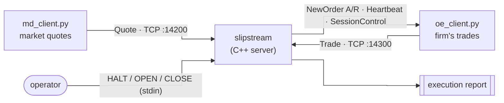
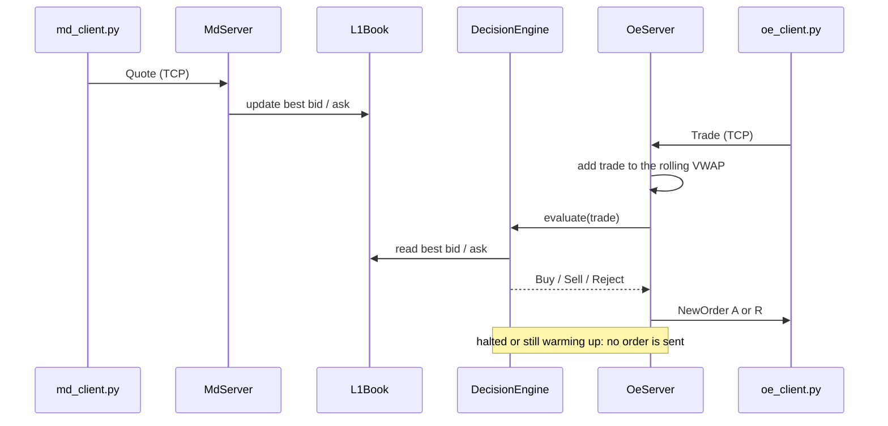

# Slipstream

A single-instrument execution server in C++20. It replays an hour of market data over TCP, keeps a
live top-of-book and a rolling VWAP for one symbol, and judges each of the firm's historical trades:
**should we have taken it?**

**Highlights**

- Single-threaded `poll()` server multiplexing two TCP connections and the console.
- Binary protocol with little-endian translation of data; messages are reassembled across arbitrary TCP splits.
- O(1)-amortized sliding-window VWAP with `__int128` running sums.
- Trading rules are pure logic, unit-tested without sockets.

## Simplified Glossary

| Term | Meaning |
|---|---|
| **Quote** | a market participant's best bid (price + quantity to buy) and best ask (price + quantity to sell) |
| **Trade** | a transaction that actually executed at a certain price + quantity |
| **L1 / top of book** | only the highest price anyone will pay (best bid) and the lowest price anyone will sell at (best ask) |
| **VWAP** | (standard math equation) volume-weighted average price: Σ(price × qty) ÷ Σ qty |
| **Rolling window** | only trades from the last N milliseconds count; older ones drop out one at a time |
| **Basis point (bp)** | 0.01%; a band of 25.5 bps means the price must be 0.255% better than VWAP |
| **Participation** | our accepted volume as a share of all market volume |

## 1. Overview

Two Python clients replay a CSV of historical quotes and trades into the server in real time (rows
300 milliseconds apart in the file are sent 300 milliseconds apart).

The server answers every trade it judges with a
`NewOrder`: `A` (accepted, we should have traded) or `R` (rejected). When the run ends it prints an
execution report.



A trade is accepted only if **all** of these hold when it happens:

| Rule | Condition |
|---|---|
| Warm-up | the feed has covered one full VWAP window **and** ≥ 10 quotes have been seen|
| Price edge | BUY: `best_ask ≤ VWAP × (1 − band)` · SELL: `best_bid ≥ VWAP × (1 + band)`, where `band = --band-bps ÷ 10,000`|
| Order size | `quantity ≤ --max-quantity` |
| Participation | `accepted qty + quantity ≤ cap × market volume`, where `cap = --participation-cap` |

## 2. Input and output

### Input: the CSV

```
Timestamp,Type,Symbol,BidPrice,BidQty,AskPrice,AskQty,Price,Qty
09:30:00.215,Q,SYNTH1,101.23,175,101.25,150,,     ← quote: bid 175 @ 101.23, ask 150 @ 101.25
09:30:13.604,T,SYNTH1,,,,,101.26,25               ← trade: 25 shares @ 101.26
```

The clients convert prices to fixed point (101.23 → 1,012,300) and send them as packed binary
messages: a 4-byte header (`body_len`, `msg_type`, `version`) followed by the body (44 bytes for a
quote, 41 for a trade).

### Output 1: the server console

```
waiting for MD client on 127.0.0.1:14200
waiting for OE client on 127.0.0.1:14300
dropped quote for SYNTH3                    ← other symbols are filtered out
dropped trade for SYNTH2
warning: no OE client traffic for 5s, sending heartbeat
```

### Output 2: what the OE client receives

```
NewOrder (1, b'SYNTH1\x00\x00\x00\x00\x00\x00', b'R', 1791784379750711112, 19, b'B', 130, 1012400)
Heartbeat (65232733328368,)
SessionControl (1791784431130868135, 2)
session state -> CLOSE
orders accepted: 0, rejected: 23
```

A `NewOrder` reads as: order id `1`, symbol `SYNTH1`, status **`R`** (rejected), send time in nanoseconds,
trade id `19` (the trade being judged), side `B`, quantity `130`, limit price `1012400` (101.24).
`SessionControl (..., 2)` is the server announcing `CLOSE`.

### Output 3: the execution report

```
=== SLIPSTREAM EXECUTION REPORT ===
symbol              SYNTH1
market qty          1890                      ← all SYNTH1 volume seen this run
executed qty        0   (0.0000%)             ← volume we accepted, as % of market
avg fill price      0.0000                    ← our volume-weighted price
session VWAP        101.2101                  ← the market's VWAP over the whole run
slippage vs VWAP    0.0000 bps   (favorable)  ← our price vs the benchmark
participation       0.0000%  (cap 15.0000%)   ← our share of volume vs the limit
```

This short run rejected all 23 trades it judged, which is the expected result for these settings:
`SYNTH1` is a tight-spread, mean-reverting symbol, so its ask rarely sits 25.5 bps (about 26 cents)
below VWAP. Loosen the band to see accepts: `./scripts/run.sh --band-bps 1 --participation-cap 0.5`.

## 3. Goal

I built this to learn low-level C++ and systems programming by doing it: modern C++ (C++17/20), POSIX sockets,
binary protocols, object-oriented design, and Python tooling. The problems
that taught me the most:

- **TCP is a byte stream.** One send can arrive in pieces, or merged with others, so the decoder
  buffers bytes until a full frame arrives.
- **Integers overflow silently.** `px × qty` overflows 64 bits before it ever reaches an
  `__int128` accumulator unless one side is widened first.
- **RAII and ownership.** Sockets are wrapped in a move-only type that closes them in its
  destructor, so none can leak or be closed twice.
- **Raw POSIX sockets.** `EINTR` retries, `TCP_NODELAY`, `MSG_NOSIGNAL`, and a single-threaded
  `poll()` loop instead of threads and locks.

## 4. Architecture

Each folder under `src/` is its own CMake library, with its headers under `include/slipstream/`:

| Module | Responsibility |
|---|---|
| `core` | fixed-point price type (price × 10,000) |
| `codec` | binary message structs, encoder, and a decoder that rebuilds messages split across reads |
| `net` | `SocketFd`: owns a socket and closes it exactly once |
| `transport` | `IFeedTransport` interface and its TCP implementation |
| `marketdata` | `L1Book` (best bid and ask) and `RollingVwap` (sliding-window VWAP) |
| `strategy` | `DecisionEngine`: applies the four rules |
| `session` | HALT / OPEN / CLOSE commands and the 5-second heartbeat |
| `metrics`, `report` | run statistics and the execution report |
| `cli` | command-line flags |
| `server` | `main`, `MdServer`, `OeServer`, and the `poll()` event loop |


How a quote and a trade flow through the server:



## 5. Run it yourself

Requirements: Linux, CMake 3.28+, a C++20 compiler (GCC 13 or recent Clang), Python 3.

```bash
cmake -S . -B build
cmake --build build
ctest --test-dir build          

./scripts/run.sh                # starts the server, then both clients
```

`run.sh` starts the server, then the MD client, then the OE client. Type `HALT`, `OPEN` or `CLOSE`
into the server while it runs. The report prints on `CLOSE` or when a client finishes.
Client output goes to `build/md_client.log` and `build/oe_client.log`.

Any flag overrides the defaults:

```bash
./scripts/run.sh --vwap-window-ms 5000                         # shorter warm-up
./scripts/run.sh --band-bps 1 --participation-cap 0.5          # looser rules, more accepted trades
```

| Flag | Default | Meaning |
|---|---|---|
| `--symbol` | `SYNTH1` | the symbol to judge; others are ignored |
| `--max-quantity` | `500` | largest order allowed |
| `--participation-cap` | `0.15` | max share of market volume |
| `--vwap-window-ms` | `30000` | VWAP window length in milliseconds |
| `--band-bps` | `25.5` | required edge vs VWAP, in basis points |
| `--md-port` / `--oe-port` | `14200` / `14300` | listening ports |

To run it by hand, start the server first, then `python3 clients/md_client.py`, then
`python3 clients/oe_client.py`.

## 6. Next steps

What I'm working on next to improve the project, I'll update this as time continues:

| Area | Plan |
|---|---|
| **Latency** | benchmark the decision path, profile it with `perf`, and publish latency metrics. Identify performance improvements. |
| **Market data over UDP** | the MD side is one-way, so UDP multicast fits. Compare its latency against TCP |
| **I/O** | non-blocking sockets with `epoll`|
| **Concurrency** | a lock-free queue between a network thread and a strategy thread |

## 7. Tested on

| | |
|---|---|
| OS | Ubuntu 24.04 (WSL2 on Windows) |
| CPU | Intel Core i5-8350U, 4 cores / 8 threads |
| Toolchain | GCC 13.3, CMake 3.28, Python 3.12 |

## License

MIT
